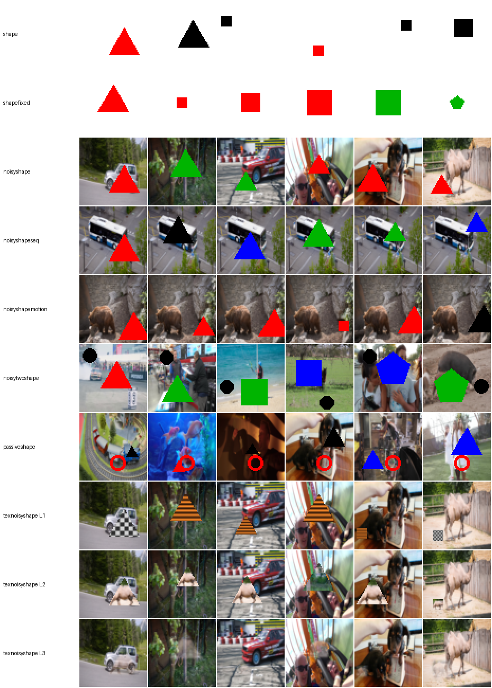

# ShapeEnv: Shape / NoisyShape diagnostic environments

`ShapeEnv` contains the controlled environments used in
**StarWM: Self-Supervised Trained Attention Routing for Robust World Models**
to analyse what a world model's latent state encodes under visual distractors.

A geometric shape whose **colour, shape and size** are changed by discrete
actions is rendered at 64×64. Objective-irrelevant factors (**position** and a
**DAVIS video background**) are re-sampled independently. The reward is
Gaussian noise, so the environments are reward-free. Every step returns the
ground-truth labels, so learned latents can be probed both at encoding time
and after open-loop imagination.

The agent code (StarWM, DreamerV3 baseline, probes, figures) is at
<https://github.com/zeqiang-zhang/StarWM>; it uses this package as a dependency.



## Installation

```bash
pip install git+https://github.com/zeqiang-zhang/ShapeEnv.git      # numpy, pillow, gymnasium
# or from a clone, with the optional probe dependencies (torch, scikit-learn, tqdm):
git clone https://github.com/zeqiang-zhang/ShapeEnv.git && pip install -e "ShapeEnv[probe]"
```

The import name is `shapeenv`.

The noisy variants draw backgrounds from **DAVIS 2017** (train+val, 480p):

```bash
wget https://data.vision.ee.ethz.ch/csergi/share/davis/DAVIS-2017-trainval-480p.zip
unzip DAVIS-2017-trainval-480p.zip
export DAVIS_DIR=$PWD/DAVIS/JPEGImages/480p    # or pass davis_path=...
```

Without DAVIS, the noisy environments fall back to random-noise backgrounds and
print a warning. That fallback was never used for any result in the paper.

## Environments

| name (`shapeenv.make`) | class | actions | what is re-sampled / special | paper |
|---|---|---|---|---|
| `shape` | `ShapeEnv` | 4 | position every step, white background | App. C.1, Table 12 |
| `shapefixed` | `ShapeFixedEnv` | 4 | nothing (shape at the centre) | App. C.1, Table 12 |
| `noisyshape` | `NoisyShapeEnv` | 4 | position + random DAVIS frame every step | Sec. 4.1, Fig. 3, Table 4 |
| `noisyshapeseq` | `NoisyShapeSeqEnv` | 4 | position every step; DAVIS video played sequentially | Table 12 |
| `noisyshapemotion` | `NoisyShapeMotionEnv` | 4 | linear motion with bounces (predictable); frame from a 20-frame pool | App. E.4, Table 11 |
| `noisytwoshape` | `NoisyTwoShapeEnv` | 8 | two shapes (large + small), positions + DAVIS frame every step | App. F.2 |
| `passiveshape` / `passiveshapeseq` | `PassiveShapeEnv` / `PassiveShapeSeqEnv` | 4 | NoisyShape plus a passive object B fixed per episode; random / sequential background | App. F.4, Table 16 |
| `texnoisyshape` (`level=1/2/3`) | `TexturedNoisyShapeEnv` | 4 | colour replaced by 4 textures: procedural (L1), DAVIS crops (L2), alpha-blended DAVIS crops (L3) | App. F.3, Table 13 |

**Actions (4-action envs).** 0/1 cycle the colour backward/forward
(red → green → blue → black). 2/3 cycle a combined shape+size counter backward/forward:
12 states, i.e. 4 shapes (circle, triangle, square, pentagon) × 3 radii
(0.10 / 0.18 / 0.26 of the image side), where size changes fastest.
**NoisyTwoShape:** 0/1 shape-1 colour, 2/3 shape-2 colour, 4/5 shape-1 shape,
6/7 shape-2 shape (each −/+). Sizes are fixed.

**Labels** (in `info`, and via `shapeenv.state_labels(env)` for the current state):
`color_id`, `shape_id`, `size_id`, `position_x`, `position_y`. Additional labels by environment:
`background_id`, `velocity_x/y` (motion), `s{1,2}_*` (two-shape),
`b_color_id`, `b_position_x/y` (passive), `texture_id` (textured).

## Usage

```python
import shapeenv

env = shapeenv.make("noisyshape", seed=0)          # davis_path defaults to $DAVIS_DIR
obs = env.reset()                                   # {'image': uint8 (64,64,3), 'is_first', 'is_terminal'}
obs, reward, done, truncated, info = env.step(3)    # Dreamer-style API; action is an int
print(info["shape_id"], info["size_id"], shapeenv.state_labels(env))
```

`reset()` returns only the observation dictionary (as in DreamerV3 code bases); episodes
never terminate on their own (the paper uses a 200-step time limit).

### Probing toolkit

These are the utilities behind the paper's latent probes (Appendix C.2).

```python
from shapeenv.collect import collect_trajectories
from shapeenv.labels import rollout_labels
from shapeenv.probe import train_clf

images, actions, is_first, labels = collect_trajectories(
    "noisyshape", num_episodes=500, env_seed=42, action_seed=0)
# ... encode `images` with your model into features of shape (N, d) ...
# train_acc, test_acc, probe = train_clf(features, labels["shape_id"].reshape(-1), 4, "cuda")
# imagined_labels = rollout_labels({"color":..., "shape":..., "size":...}, imagined_actions, horizon=15)
```

- `collect_trajectories` rolls out a uniform random policy and records images, one-hot actions and labels.
- `labels.rollout_labels*` compute the ground truth after *h* imagined actions
  (single shape, linear motion, two shapes).
- `probe.train_clf` / `train_reg` implement the paper's protocol. The probe is a 3-layer MLP
  (256 hidden units, dropout 0.2) trained on a 70/30 split with Adam (lr 1e-3, weight decay 1e-4)
  and early stopping (patience 10).
- `labels.position_chance_mse()` gives the chance-level position MSE of 0.0711.

`examples/random_rollout.py` and `examples/gallery.py` show complete scripts.

## Tests

```bash
pip install -e ".[test]" && pytest tests
```

The tests check that every environment is deterministic given its seed, and that the label
roll-outs agree with the environments' own dynamics.

## Citation

```bibtex
@inproceedings{zhang2026starwm,
  title     = {StarWM: Self-Supervised Trained Attention Routing for Robust World Models},
  author    = {Zhang, Zeqiang and Wurzberger, Fabian and Otte, Maximilian and Schmid, Daniel and
               Gottwald, Sebastian and Raulf, Arne Peter and Braun, Daniel Alexander},
  booktitle = {The 40th Annual Conference on Neural Information Processing Systems (NeurIPS 2026)},
  year      = {2026}
}
```

## License

MIT (see `LICENSE`). DAVIS 2017 is distributed under its own terms by its authors.
